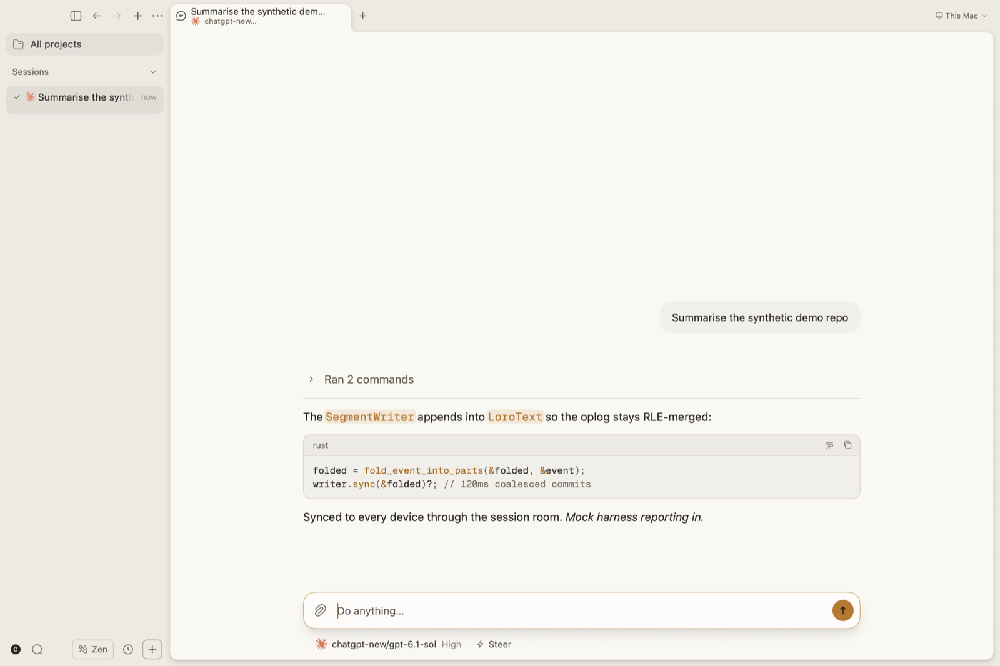
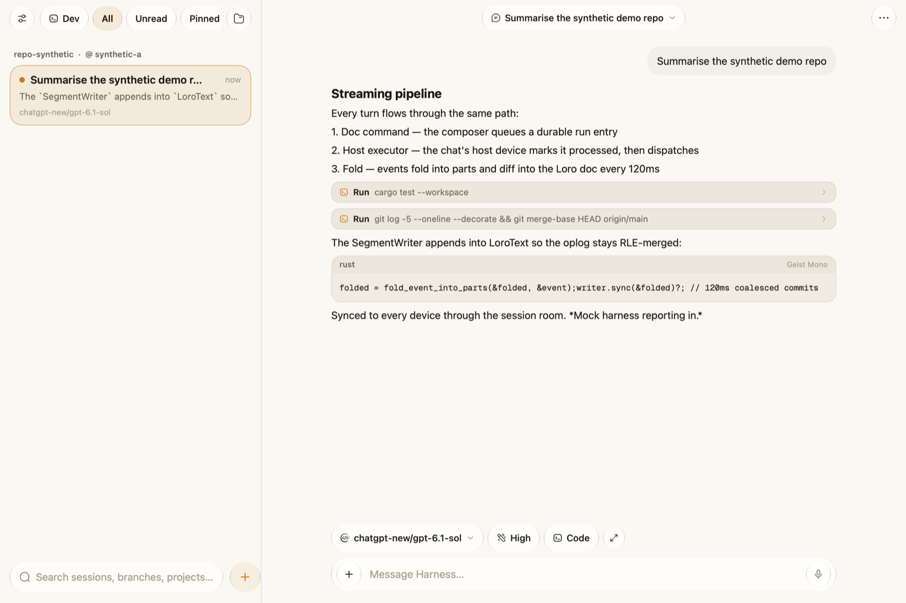

# The Zig engine against the local edge

`scripts/local-edge.sh check` runs the edge Worker (`edge/`) with
`wrangler dev --local` (Miniflare/workerd, state in a temporary folder,
`edge/wrangler.local.jsonc`) and two Zig `harness-engine headless` processes
as two devices of one made-up user. It is the first run of the Zig engine
against the real Worker code; before it, the engine was only tested against
in-process fakes of the edge.

Everything stays on the machine: no Cloudflare account, no deployed edge, no
secrets. Wrangler runs with metrics, error reports, its npm update check and
the `request.cf` download turned off, and the check samples every process it
started for non-loopback connections (reported below).

## How sign-in works here

The Worker authenticates with `edge/src/auth.ts` `verifyToken`. Deployed
(`AUTH_MODE=codegraff`) it takes only its own HS256 JWTs, which it issues
after a CodeGraff OAuth code exchange (`/auth/exchange`, against
`codegraff.com`, hard-coded in `edge/src/codegraff.ts`) or a cloud sandbox's
lease token (`/auth/sandbox`, against the gateway). Production authentication
is unchanged by the local workflow.

The local edge instead requires explicit `AUTH_MODE=local`. The runner
creates a fresh opaque random session and a made-up `ada-xxxxxx` identity
per run, injecting them into the loopback-only Worker. The checked-in config
contains neither an authorizing session nor a signing key. Unlike legacy
`AUTH_MODE=dev`, arbitrary `user@org` strings are not credentials here.

The engine requires `HARNESS_LOCAL_EDGE_AUTH=1`, `HARNESS_EDGE_TOKEN`, and
an exact `http://127.0.0.1:<port>` origin (no DNS, credentials, path or query).
It starts signed out and calls `GET /auth/local-session` with the opaque
bearer under a five-second socket deadline. Only a successful, correctly
shaped local response supplies the user and org and permits sign-in. A
conflicting `HARNESS_ORG_ID` is rejected, not adopted. Absent, invalid, stale,
malformed, unreachable and non-loopback sessions fail closed. The real
Worker check also starts an engine with a forged session and requires its
startup to fail. Local mode rejects production OAuth/refresh/sandbox routes
before any external identity-provider call; production mode never accepts
the local session.

This is intentionally not an OAuth exchange, refresh rotation or JWT expiry
test. It covers verified local bootstrap, the registry, the device room,
chat tails, blobs and rooms. Sessions last only for their temporary local
Worker run; `down` (or the watchdog) stops that run.

## Mismatches found

Fixed in Zig, each with a test that fails without it:

1. **A development bearer never reached the edge.** `engine_main.zig` set
   `HARNESS_EDGE_TOKEN` as the key but never the edge URL in development
   mode, so the registry sync and the device relay returned before their
   first request. `dev_edge_auth.zig` now sets the URL and adopts only the
   user and org verified by the local Worker. Follow-up security regressions
   reproduced the arbitrary-bearer sign-in before fixing it: `dev edge auth:
   a bearer alone cannot bypass production or unavailable local auth` and
   `dev edge auth: explicitly local auth never signs in without a live
   session` both failed on merged local-edge before the hardening. Tests
   also check origin parsing, org mismatch and malformed responses.
2. **A prompt for another device's chat ran on the wrong machine and erased
   the host's history on the Worker.** Device B ran the turn itself, then
   `PUT /chat2/:id/tail` with only its own turn, which the Worker serves as
   the chat's history. B's attachment upload also stayed on B. `relay_dial.zig`
   now dials the Worker's DeviceRoom as a client (`/device/:id/ws?role=client`)
   for one call: a remote `targetDeviceId` call runs on that device, and a
   `QueueCommand` for a chat another device hosts goes to the host as
   `RelayCommand` with a durable entry. Test: `relay dial: a run for a chat
   another device hosts runs on that host, and an upload lands there`.
3. **A remote chat's transcript never refreshed.** B fetched the host's tail
   once and never again, and an open chat (with an empty local doc) was never
   prefetched. `remote_tail.zig` now drops the cached tail when a remote
   chat's `chats`/`sessions` row changes, prefetches open-but-empty chats, and
   the host now PUTs its tails before it pushes the rows that announce them.
   Only rows from the edge count: the saved registry an engine replays at
   start keeps its saved tails. Tests: the three `remote tail:` tests, and the
   existing `Zero-latency SSD registry-cache.json + tail disk cache
   round-trip` for the replay.

Open:

4. **No chat2 log rows (Loro).** The Zig engine never opens
   `/chat2/:id/ws`; the chat's log on the Worker stays at `headSeq 0`, and
   history reaches other devices only through the tail sidecar. A Rust or Swift
   client opening a Zig-hosted chat gets the tail (instant open) but no live
   doc, and a command it writes into the doc never reaches the Zig host (only
   `RelayCommand` does). `chat2_client.zig` is only used in tests. Keep Loro:
   integrate the existing implementation through a compatible bridge rather
   than rewriting the codec in Zig (see the inventory below).
5. **No tool-output sidecars.** The engine never uploads
   `PUT /blob/:chat/:part` for a long tool output or diff; `FetchToolBlob`
   reads a blob the Worker holds correctly. The upload belongs where the turn
   folds a tool result (`turn_host.zig`), queued like the tails in the sync
   worker: roughly 100 to 150 lines, no Worker change.
6. **The non-background sync path still pushes rows before tails.**
   `EngineHost.syncFromEdgeRegistry` (`engine_host.zig`, the locked variant
   used when the background worker is off) has the old order. The headless
   engine uses `syncFromEdgeRegistryUnlocked`, which is fixed. Moving one
   block, as in fix 3.
7. **One device-room socket per forwarded call.** `relay_dial.zig` doesn't
   cache peer links as Rust's `LinkCache` does, so a large attachment dials
   once per chunk. A small per-target cache in that file.
8. **Remote turns show up at row changes, not while they stream.** A second
   device sees the host's turn when its chat or session row changes (start
   and end), not token by token, which Rust gets from chat2 rows (see 4).

Worker behaviour the engine follows, not mismatches:

- `POST /auth/orgs` answers 405 in every auth mode: the Worker only has the
  personal workspace. The check asserts the 405 instead of creating an org.
- In development mode the engine's `ListOrgs` answers `[]` without asking the
  Worker, as Rust's engine without CodeGraff does.
- Without Hyperdrive, dev auth keeps agent rooms in the Worker's in-memory
  store, so an edge restart empties them. Step 8 doesn't check rooms.

## Committed reusable Loro support and remaining interoperability

Loro is retained, not replaced by a Zig rewrite. This merge removes none of
its implementation or dependencies:

- `crates/doc/src/schema.rs` and `crates/doc/Cargo.toml`: the real Rust Loro
  session schema, LoroText streaming parts, commands and movable queue.
- `crates/engine/src/chat2_host.rs` and `crates/sync/src/chat_client.rs`:
  existing host/client wiring and snapshot/update transport for those docs.
- `edge/src/session-room.ts`, `edge/src/session-doc/`, and `edge/package.json`:
  the existing Loro materializer/legacy room and JS Loro dependencies;
  chat2 remains a byte relay for compatible document updates.
- `apps/ios/Harness/Sync/DocDisk.swift`, `ChatRoomClient.swift`,
  `SessionStore.swift`, and `SessionQueue.swift`: committed Swift Loro
  persistence, chat2 client, session store and queue integration.

This is reusable implementation, **not functioning Loro sync in the Zig
engine**. The committed nano build contains no Loro ABI bridge. Its
`session_doc.zig` writes a private `HZD1` document format and explicitly
returns `UnsupportedLegacyLoroBlob` for Loro input. Its chat2 state machine
and shared wire vectors do not make that format Loro-compatible. Required
follow-up: bridge the retained Loro session operations and snapshots,
connect chat2 into the live Zig host, persist/import compatible frontiers
and updates, execute document commands, and prove Rust/Swift/Zig bidirectional
streaming, queue edits, offline merge and restart interoperability using
synthetic data. No uncommitted bridge or other session's worktree was read
or copied. Retaining `crates/` and `edge/` is distinct from whether legacy
`tui/` is included in a future repository.

## Historical branch test evidence (not integration validation)

One pre-integration full `zig build test` run on the local-edge branch: 1332 of 1339 passed, 2 skipped,
5 failed. The registry-cache round-trip failure came from fix 3 and is fixed
(the replay rule above). The other four fail the same way with the base
commit's sources: `catalog_graff an older graff without the extension uses
route and models`, the two `catalog_devin` catalog tests, and `git_host: a
folder git can't read answers git's own error` (crashes). None of them touch
the code changed here.

## `up`

`scripts/local-edge.sh up --phone` leaves the local edge, engine A (signed
in, a synthetic repo, a mock chat with one turn) and engine B running, and
opens `harness-nano` on A's profile and `harness-nano --mobile` on B's.
Each app gets its own HOME, data folder, port and engine (no engine start of
its own, no release check, no graff download).

In this session the display was asleep, so `screencapture` returned black
frames. These two images were drawn by the same binary on the same profiles
and engines with nanoui's offscreen renderer (`--nanoui-snapshot`): A's
desktop window, and B's phone layout showing A's chat (`@ synthetic-a`), read
from the Worker.

## Last run

<!-- local-edge:run:begin -->
Last `scripts/local-edge.sh check` run: commit `36203a1f`, harness-engine 0.2.186, Zig 0.17.0, Node v24.10.0, wrangler 4.120.0 (the lockfile's). Passed; run 3 of 3 in a row.

| Step | | Result | Time | Detail |
|---|---|---|---|---|
| 1 | local edge starts on fresh persisted state | pass | 1.2 s | wrangler dev --local, dev auth, 2 loopback ports |
| 2 | engine A (Zig) starts against it | pass | 0.6 s | harness-engine 0.2.186, scope development |
| 3 | A signs in, org, device registered | pass | 0.0 s | CLI status ok; AuthStatus signedIn ada-pvio0o in user-ada-pvio0o (= /auth/orgs); engine ListOrgs [] (dev mode); org creation not offered by the Worker (405); device row + relay host online (1 socket) |
| 4 | A: project, mock chat, turn, transcript | pass | 0.1 s | 2 messages read back, assistant complete, 2 tool parts |
| 5 | the Worker holds the chat row and its history | pass | 0.5 s | chats row (title "Summarise the synthetic demo repo", host A), spaces row present; /chat2/:id/tail 2 messages with the turn; chat2 log headSeq 0 |
| 6 | engine B: lists, reads, relays a prompt to A | pass | 2.7 s | B lists "Summarise the synthetic demo repo" hosted on A and reads it; B's prompt ran on A, reply on B, Worker tail has both turns |
| 7 | rooms, tool blob, attachment | pass | 0.1 s | room: B read A's post; tool blob: skipped, no turn produced one (the Zig engine uploads no tool sidecars); FetchToolBlob of a Worker-held blob ok; attachment: landed in A's uploads, relayed prompt ran on A |
| 8 | edge and A restart on the same state | pass | 2.3 s | A signed in again (dev bearer), chat + both turns local, Worker tail + rows persisted, a rename synced |
| 9 | everything stopped, no process or port left | pass | 0.3 s | 3 process groups stopped; 14 ports closed |

Non-loopback connections seen from the edge and engines during the run: none.
- chat2 log for the chat: headSeq 0 (the Zig engine writes no Loro rows; history is the host-published tail)
- agent rooms are in the Worker's in-memory dev store without Hyperdrive, so an edge restart empties them
<!-- local-edge:run:end -->
