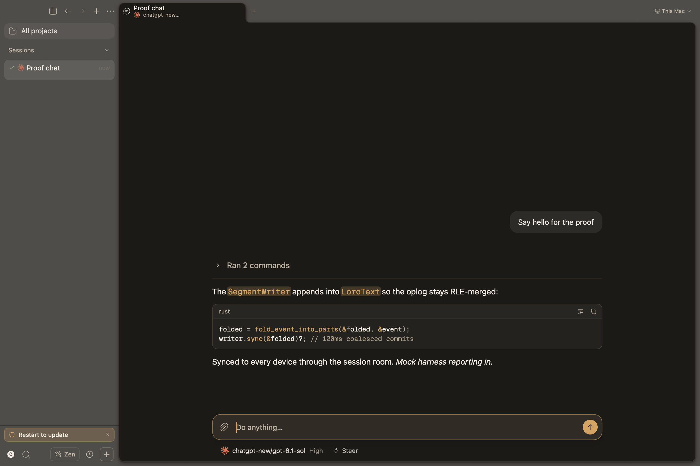

# Zig-only proof

- Commit: `fd0977d1`
- Zig: 0.17.0
- Result: pass
- Tests (no crates/, Cargo.toml or Cargo.lock): 1520/1522 tests passed (2 skipped)
- Fake arms (RPC methods still answering canned data, src/fake_arm_gate.zig): 20

| Step | Result | Time |
|---|---|---|
| no-rust | pass | 6 s |
| tests-without-rust | pass | 222 s |
| bundle | pass | 306 s |
| bundle-contents | pass | 0 s |
| proof-repo | pass | 0 s |
| engine-up | pass | 1 s |
| engine-scenario | pass | 1 s |
| desktop-render | pass | 6 s |

## Auth confinement follow-up

The full fresh-cache proof above tested implementation commit `fd0977d1`;
it does not claim to validate later changes. Commit `1690f125` adds only
configuration assertions and real-Worker authorization checks (no production
implementation changes). Its focused `zig build test -Dtest-filter='dev edge
auth' --summary all` passed 24/24, including the new normal-defaults,
missing/blank endpoint and rejected-state assertions. Both Zig commands used
`scripts/heavy-build.sh` and the integration worktree's sibling
`zigfull.lock`.

On `1690f125`, `LOCAL_EDGE_NO_BUILD=1 scripts/local-edge.sh check --proof
--max-minutes 8` passed all nine steps against the real local Worker and
two Zig engines. It verified protected-registry responses of 401 without a
bearer, 200 for the permitted org and 403 for a different org, plus forged
session startup rejection, cross-device turns/attachments and restart.
Cleanup verified three process groups stopped and 15 ports closed.
No non-loopback connections were observed by the sampler (not a packet-level
isolation proof). Engine-produced tool sidecars remain skipped/unsupported;
reading a Worker-held blob passed. See `LOCAL-EDGE.md` for the step table.

The edge's `npm test` passed 261 unit tests and 47 workerd tests on the
hardened implementation. `npm run typecheck:tsc` passed. The two original
arbitrary-bearer/unreachable-edge Zig regressions were first observed failing
before hardening, then passing after it; they were introduced on local-edge,
not claimed as a reproduction against an unrelated main revision.

The isolated `up --phone --no-app --ttl-minutes 3`, `status`, and `down`
lifecycle passed with a fresh temporary TMPDIR (its own control pointer),
two Zig engines and a local Worker; all four process groups were stopped and
the temporary state removed. No personal profile or existing local-edge run
was used.

Formatting: `zig fmt --check` passed for `dev_edge_auth.zig` and
`engine_main.zig`. `engine_cli.zig` has pre-existing command-table layout
differences at lines 64–68, outside the changed auth configuration, left
unchanged. Shell/Node syntax checks and `git diff --check` passed.

The proof generator deletes all PNGs in this proof directory before rendering
its own screenshot. The two imported local-edge evidence PNGs were restored
verbatim from the committed blobs afterwards; this scoped auth integration
does not change that generator's cleanup policy.

## Engine scenario

The bundle's harness-engine, isolated (temporary HOME, data folder and port, auth off, previews on a free port):

```json
{"commandId": "m-proof-1", "git": {"additions": 1, "diffFiles": ["README.md"], "statusKeys": ["checkoutId", "complete", "deviceId", "files", "revision"]}, "seconds": 0.46, "terminal": {"echo": "proof-42"}, "transcript": {"messages": 2, "prompt": ["Say hello for the proof"], "replyHasMockText": true}, "turn": {"device": true, "status": "idle"}}
```

## Images



iOS simulator: skipped: a booted simulator holds the person's own Harness install, which the proof does not replace.
