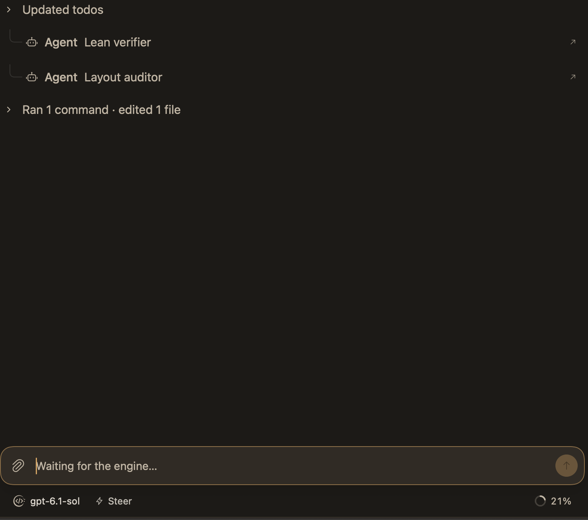
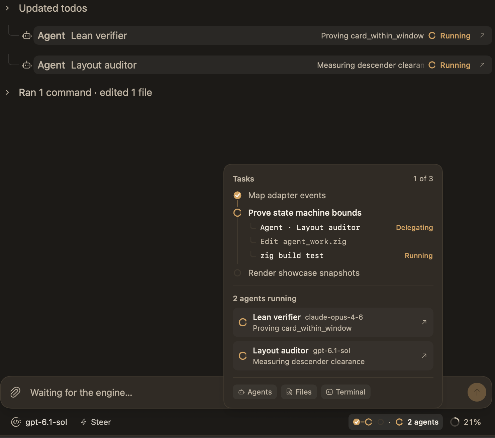

# Harness #809 → NanoHarness desktop port

Baseline: NanoHarness `6ced23c39` (v0.2.213). Source: Harness PR #809,
head `3daad878e`, cumulative diff against merge base `a1dc58480`.
The source PR was open and unmerged when inspected. No GitHub writes were made.

## Reproduced before implementation

Synthetic tests were added before applying the implementation:

- `cargo test -p harness-adapters --lib acp::normalize::tests::graff_`:
  5 passed, **3 failed**. The failures were
  `graff_todo_write_maps_to_typed_todo_checklist` (Unknown instead of Todo),
  `graff_subagent_progress_frame_preserves_parent_agent_call_and_streams_tail`
  (progress retyped the parent spawn), and
  `graff_waiting_session_info_emits_live_progress_without_opening_turn`
  (waiting metadata produced no live progress).
- `cargo test -p harness-engine --lib sessions::tests::parked_session_streams_cross_turn_tool_progress_without_unparking`:
  **failed**, expected waiting + subagent progress but received zero records.
- `zig build test -Dtest-filter='809 Agent Work'`:
  14 passed, **1 failed** at the missing `2 agents` footer assertion.

All heavy commands, including the commands above, were run through
`scripts/heavy-build.sh`. Zig commands used Zig 0.17.0 with the build's LLVM
backend, never the self-hosted backend. Build outputs were local to this tree.

## Passing after port

From the repository root (Zig commands from `apps/nano`):

| Command (always wrapped with `scripts/heavy-build.sh`) | Result |
| --- | --- |
| `cargo test -p harness-adapters --lib acp` | 160 passed |
| `cargo test -p harness-adapters --lib acp::normalize` (final added cases) | 27 passed |
| `cargo test -p harness-engine --lib sessions::tests` | 13 passed |
| `zig build test -Dtest-filter='809' --summary all` | 25 passed |
| `zig build test -Dtest-filter='subagent' --summary all` | 21 passed |
| `zig build test -Dtest-filter='retention 309' --summary all` | 19 passed |
| `zig build snap -- ../../evidence/pr809/scene.json ../../evidence/pr809/scene-capture` | Passed; synthetic progress envelope, footer/popover expectations and capture |

The Zig build also ran its 28 native-math Rust tests successfully. The targeted
Zig gates cover the existing shared build-wait watch, snapshot isolation,
numeric waiting IDs, structured todos, live tails, parked waiting clearing,
subagent status transitions, parent queue/steer routing, and preservation of
the main composer draft. Existing tool-tree invocation retention remains intact.

`zig fmt --check` passed for every touched Zig file. `git diff --check` passed.
`rustfmt --edition 2024 --config skip_children=true --check` still reports
pre-existing formatting differences: 9 ranges in normalize.rs, 10 in acp/mod.rs,
and 19 in sessions.rs. Comparing formatter edits against the unchanged baseline
found **zero newly introduced formatting differences**; build_wait.rs is clean.
Unrelated formatting was not changed.

## Before

## After

Additional fresh synthetic screenshots:

- `after/agent-work-popover-dark.png`
- `after/agent-work-popover-light.png`
- `after/todo-checklist-dark.png`
- `after/parked-waiting-dark.png`
- `after/subagent-surface-dark.png`
- `after/subagent-surface-light.png`
- `scene-capture/01-agent-work-scene.png`

The captures use `ui.Tester` and `NANO_SNAP_DIR`, at 1280×820 logical points,
2× scale. The before and after crops use the identical source rectangle.
The Tester, Metal initialization and snapshot entry point were inspected before
running helpers: no application launch, window presentation, activation, global
input, live engine, or user data is involved. Functional offscreen coverage is
not an OS-observed isolated-desktop focus/cursor/cleanup verification.

## Integration notes

- The existing `requests.watchToolProgress` API and protocol vector remain
  unchanged. The existing `app_progress.zig` per-visible-chat feed owns the new
  parsed tails/waiting state; there is no second progress subscription.
- `app_progress.forChat(app, optional_chat_id)` returns its read-only snapshot.
  `app_progress.apply(app, chat_id, json)` accepts either the RPC `{items: [...]}`
  envelope or the older synthetic array shape. Snapshot scenes use `toolProgress`.
- Steer/follow-up routes through the parent queue, using its established
  promotion path when live steering is available. It never focuses/runs a child
  document or temporarily replaces the main composer and its attachments.
- Minimal integration hunks are in app.zig, view.zig, tests.zig and snap.zig.
  No selection gestures, clipboard feedback, model picker, attachment drop,
  access-map failure badge, speech, or Cargo manifests/lockfiles were changed.

## Limitations and source PR recommendation

Lean is not installed in this environment. The source proof kernel was ported,
its stale-running rule aligned with the Zig implementation, and the proof runner
updated, but Lean execution is **unverified**. Real-provider end-to-end streams,
foreground native interaction, other platforms and the entire repository test
suite were not run.

An intermediate Zig build failed on an unused local during adaptation; it was
removed before the passing final gates. This was a compile failure, not an app
crash. No helper crash or foreground interaction occurred.

Keep source PR #809 open until the consolidated NanoHarness migration lands;
then close it as superseded with the final migration link. This port covers its
remaining desktop/ACP/engine scope; no source issue/PR state was changed here.
